# DEVOPS-4: Troubleshooting a Broken Nomad Deployment (Nginx)

## 1. Project Overview

This project involved troubleshooting and fixing a broken Nginx deployment running on HashiCorp Nomad, with Consul used for service registration and health monitoring.

The objective was to identify configuration issues preventing the application from deploying and becoming healthy, apply the necessary corrections, and verify that the Nginx application was accessible.

The original deployment contained several issues involving the Nomad datacenter, Docker image, container port mapping, health-check endpoint, and Docker port publishing.

## 2. Objectives

- Deploy an Nginx application using Nomad.
- Identify and troubleshoot deployment failures.
- Inspect Nomad allocations and task logs.
- Resolve Docker image and networking issues.
- Configure service health checks.
- Verify service registration and health through Consul.
- Confirm application accessibility through a browser.

## 3. Environment and Tools

The troubleshooting exercise was performed in a local Ubuntu environment running through Windows Subsystem for Linux (WSL).

| Component | Description |
|---|---|
| Operating System | Ubuntu on WSL |
| Container Runtime | Docker |
| Container Image | nginx:alpine |
| Orchestration | HashiCorp Nomad |
| Service Discovery | HashiCorp Consul |
| Application | Nginx |
| Configuration | HCL |
| Testing | curl and Web Browser |

Nomad and Consul were started in development mode for the local single-node environment.

### Version Information

The installed versions were verified using the respective CLI commands.


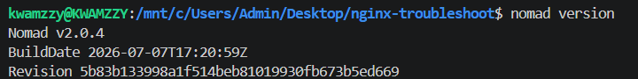

### Repository Structure

```text
nginx-troubleshoot/
├── Dockerfile
├── index.html
├── nginx.hcl
├── nginx-fixed.hcl
├── README.md
└── screenshots/
```

The original `nginx.hcl` was preserved, while all corrections were implemented in a separate `nginx-fixed.hcl` file.

## 4. Environment Setup

### 4.1 Starting Consul

Consul was started in development mode:

```bash
consul agent -dev
```

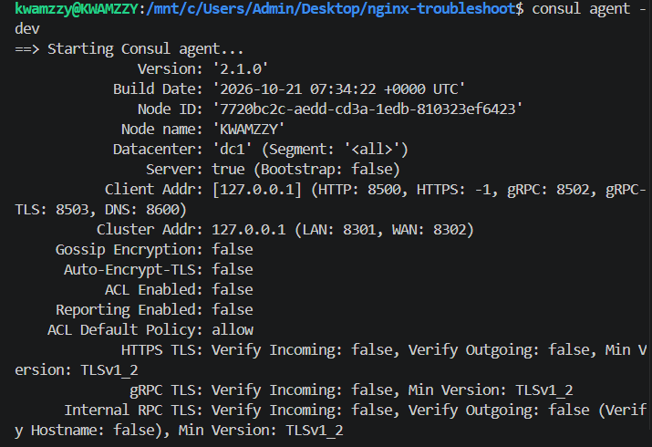

### 4.2 Starting Nomad

Nomad was started in development mode in a separate terminal:

```bash
nomad agent -dev
```

### 4.3 Verifying Cluster Health

The Nomad node and Consul cluster membership were checked to confirm that both agents were running.

```bash
nomad node status
consul members
```

The Nomad node was registered and ready in datacenter `dc1`.

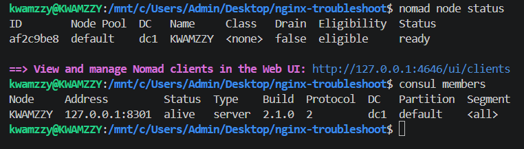

## 5. Initial Deployment and Failure Investigation

The original Nomad job was submitted using:

```bash
nomad job run nginx.hcl
```

The deployment failed with:

```text
No nodes were eligible for evaluation
```

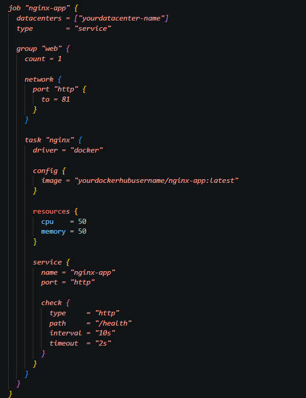

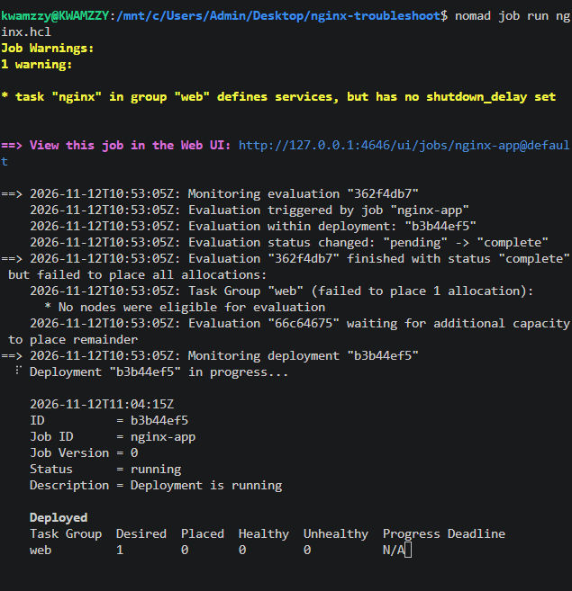

Further investigation using:

```bash
nomad node status
nomad job status nginx-app
```

showed that the local Nomad node belonged to datacenter `dc1`, while the job configuration referenced a placeholder datacenter named `yourdatacenter-name`.

This prevented Nomad from placing the allocation on the available node.

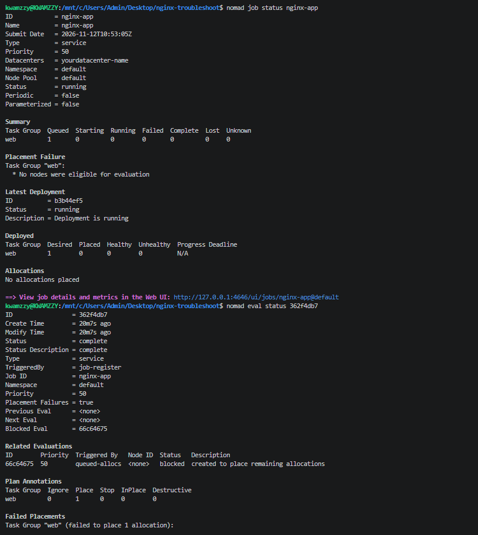

### 5.1 Correcting the Datacenter

The original configuration contained:

```hcl
datacenters = ["yourdatacenter-name"]
```

The actual Nomad node belonged to `dc1`.

The configuration was corrected to:

```hcl
datacenters = ["dc1"]
```


## 6. Docker Image Troubleshooting

After correcting the datacenter, the job was submitted again. This time, Nomad attempted to pull the configured Docker image but failed.

The original configuration referenced a placeholder Docker Hub image:

```hcl
image = "yourdockerhubusername/nginx-app:latest"
```

The image could not be pulled because the referenced repository did not exist or was inaccessible.

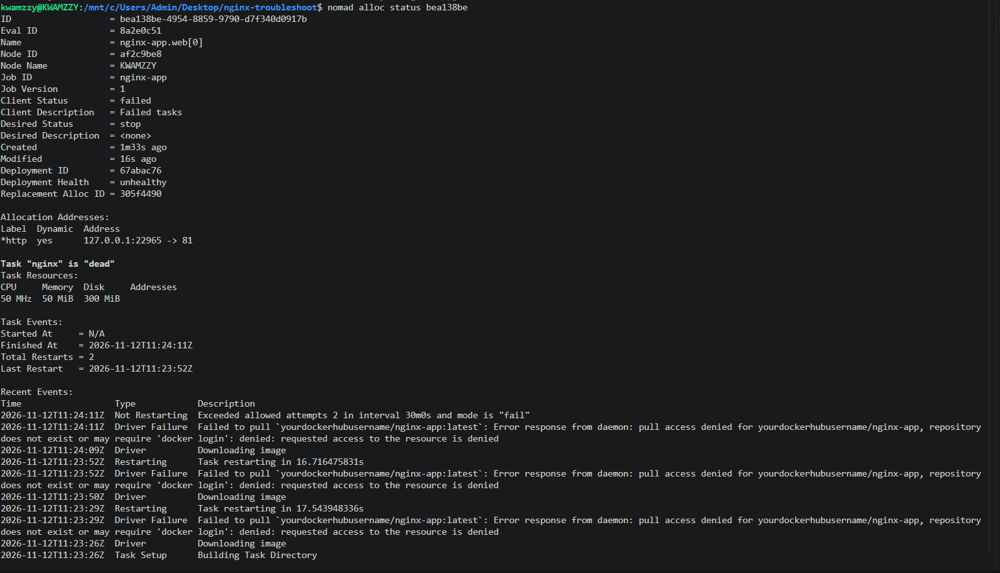

### 6.1 Building a Local Docker Image

Instead of relying on the unavailable placeholder image, a local Nginx image was built using the existing Dockerfile.

```bash
docker build -t nginx-app:local .
```

The build completed successfully.

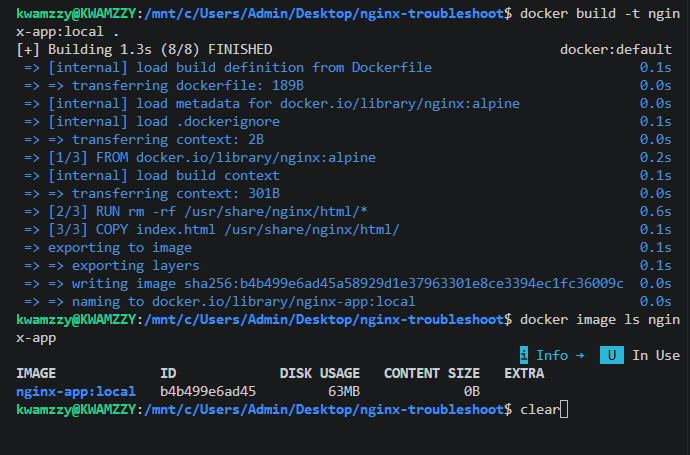

The Nomad Docker configuration was updated to use the local image:

```hcl
config {
  image      = "nginx-app:local"
  force_pull = false
}
```

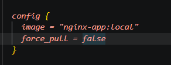

The job was redeployed, and the Nginx container started successfully.

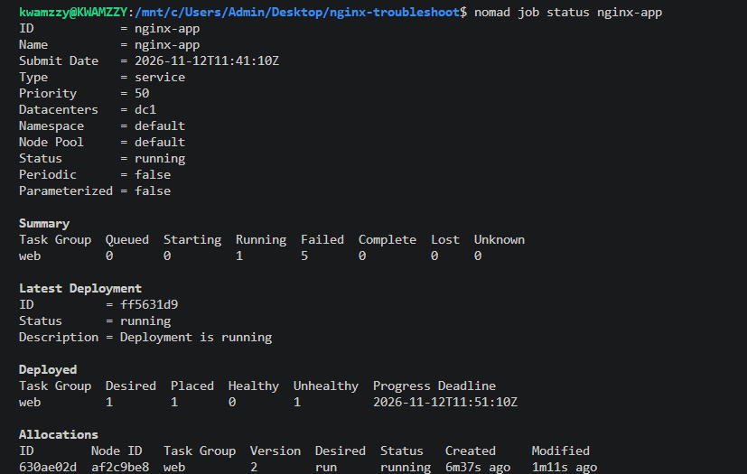

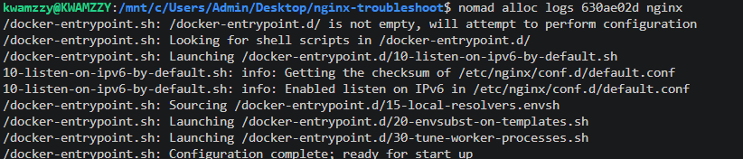

## 7. Allocation Health and Networking Troubleshooting

Although the Nginx container was running, Nomad initially reported that the allocation was unhealthy.

The allocation inspection showed that traffic was being forwarded to container port `81`, while Nginx listens on port `80`.

The service health check also referenced `/health`, an endpoint that did not exist in the application.

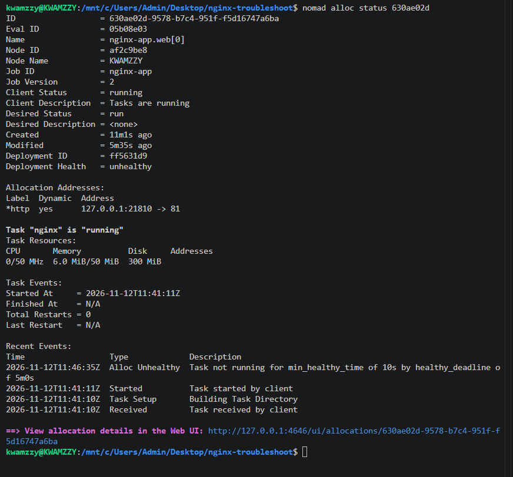

### 7.1 Correcting the Container Port

The original network configuration used:

```hcl
network {
  port "http" {
    to = 81
  }
}
```

It was corrected to:

```hcl
network {
  port "http" {
    to = 80
  }
}
```

### 7.2 Correcting the Health-Check Endpoint

The original health check used:

```hcl
check {
  type     = "http"
  path     = "/health"
  interval = "10s"
  timeout  = "2s"
}
```

However, the application served its homepage from `/`.

The health-check path was therefore changed to:

```hcl
check {
  type     = "http"
  path     = "/"
  interval = "10s"
  timeout  = "2s"
}
```

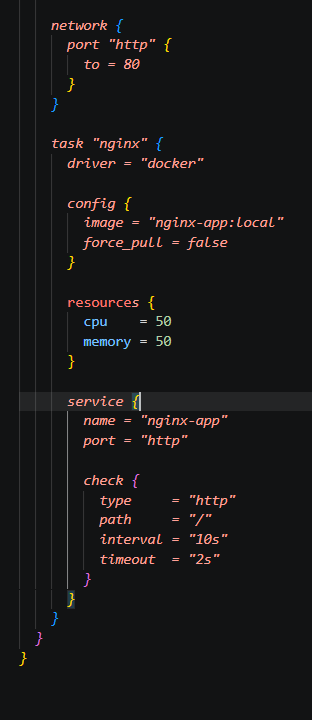

The corrected settings were verified before redeployment.

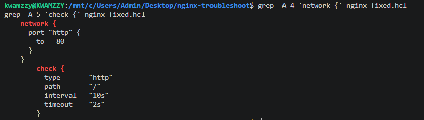


### 7.3 Implementing a Dedicated Nginx Health Endpoint

Following mentor feedback, the health-check implementation was improved by creating a dedicated `/healthz` endpoint instead of relying on the application homepage.

A custom Nginx configuration file named `default.conf` was created.

The configuration defines a dedicated health endpoint:

```nginx
location = /healthz {
    access_log off;
    default_type text/plain;
    return 200 "healthy\n";
}
```

When Nginx receives a request to `/healthz`, it returns an HTTP 200 response with the message `healthy`.

The existing homepage configuration was retained to ensure that normal application requests continued to work.

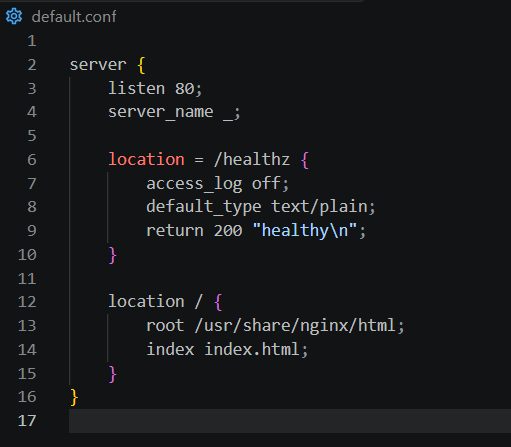

The custom configuration was copied into the Nginx container through the Dockerfile:

```dockerfile
COPY default.conf /etc/nginx/conf.d/default.conf
```

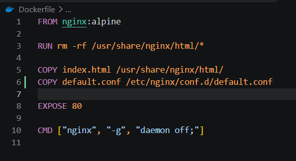

The Docker image was rebuilt to include the new Nginx configuration.

The Nomad service health check was also updated to use the dedicated endpoint:

```hcl
check {
    type     = "http"
    path     = "/healthz"
    interval = "10s"
    timeout  = "2s"
}
```

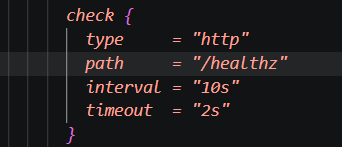


## 8. Docker Port Publishing Issue

After correcting the container port and health-check endpoint, the Nginx task was running, but the application was still inaccessible through the dynamically allocated host port.

The following command was used to inspect the running Docker container:

```bash
docker ps --filter "name=nginx"
```

The container showed port `80/tcp`, but no published host port.

Further inspection was performed using:

```bash
docker inspect $(docker ps -q --filter "name=nginx") \
  --format 'NetworkMode={{.HostConfig.NetworkMode}} Ports={{json .NetworkSettings.Ports}}'
```

The output showed:

```text
NetworkMode=bridge Ports={"80/tcp":null}
```

This indicated that Docker had not published the container port to the host.

### 8.1 Adding the Docker Port Publishing Configuration

The Docker configuration was updated to explicitly publish the port labelled `http` in the Nomad network configuration.

```hcl
config {
  image      = "nginx-app:local"
  force_pull = false
  ports      = ["http"]
}
```

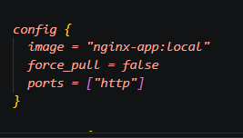

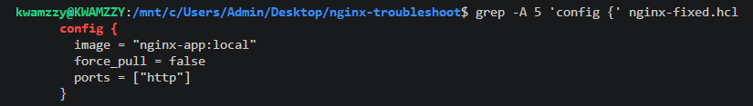

This allowed the Nomad Docker driver to publish the dynamically allocated host port and forward traffic to container port `80`.

## 9. Final Working Configuration

The corrected `nginx-fixed.hcl` contains:

```hcl
job "nginx-app" {
  datacenters = ["dc1"]
  type        = "service"

  group "web" {
    count = 1

    network {
      port "http" {
        to = 80
      }
    }

    task "nginx" {
      driver = "docker"

      config {
        image      = "nginx-app:local"
        force_pull = false
        ports      = ["http"]
      }

      resources {
        cpu    = 50
        memory = 50
      }

      service {
        name = "nginx-app"
        port = "http"

        check {
          type     = "http"
          path     = "/"
          interval = "10s"
          timeout  = "2s"
        }
      }
    }
  }
}
```

The corrected configuration was deployed using:

```bash
nomad job run nginx-fixed.hcl
```

## 10. Final Verification and Testing

### 10.1 Nomad Deployment Status

The deployment was checked using:

```bash
nomad job status nginx-app
```

The final output confirmed:

- Job status: `running`
- Deployment status: `successful`
- Desired allocations: `1`
- Placed allocations: `1`
- Healthy allocations: `1`
- Unhealthy allocations: `0`

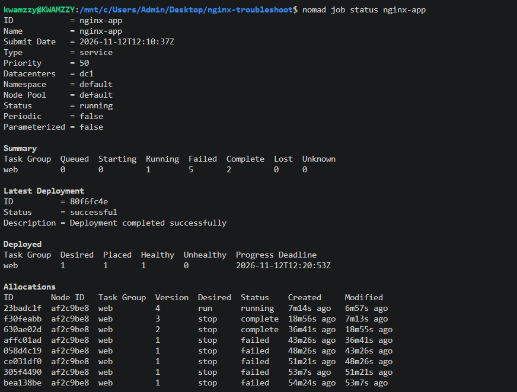

### 10.2 Healthy Allocation

The allocation was inspected using:

```bash
nomad alloc status 23badc1f
```

The application was running with the dynamically allocated address:

```text
127.0.0.1:20057 -> 80
```

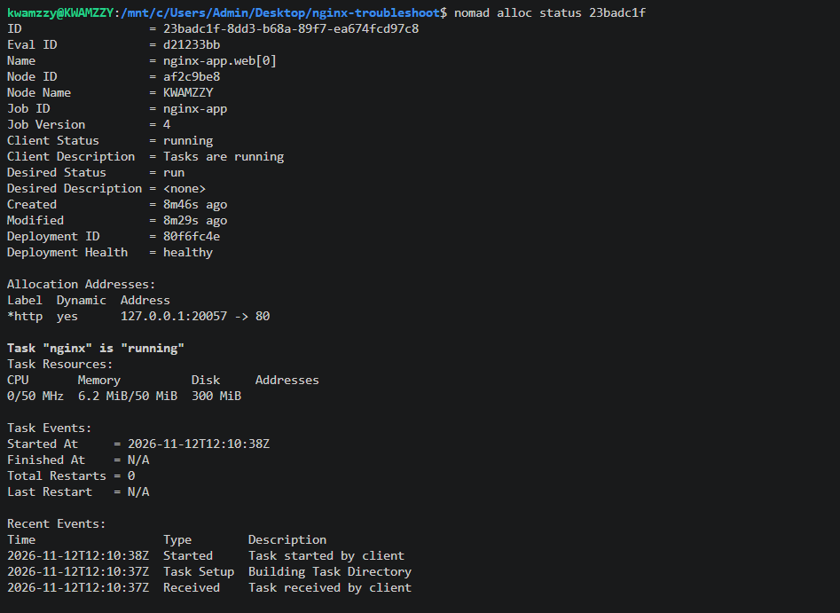

### 10.3 Nginx HTTP Verification

The application was tested using:

```bash
curl -i http://127.0.0.1:20057/
```

The server returned:

```text
HTTP/1.1 200 OK
Server: nginx/1.31.8
Content-Type: text/html
```

The response body contained:

```html
<h1>Welcome!!</h1>
```

This confirmed that Nginx was serving the application successfully.

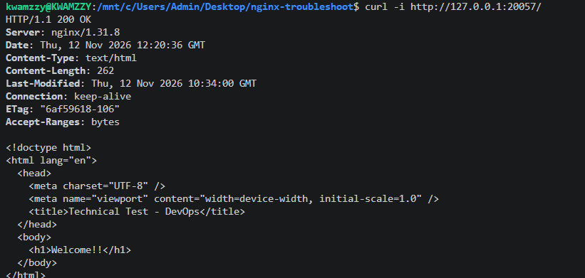

### 10.4 Consul Service Registration

The registered services were checked using:

```bash
consul catalog services
```

The output confirmed that `nginx-app` was registered in Consul.

The Consul HTTP API was then used to inspect the service health:

```bash
curl -s "http://127.0.0.1:8500/v1/health/service/nginx-app?pretty"
```

The HTTP health check returned:

```text
Status: passing
Output: HTTP GET http://127.0.0.1:20057/: 200 OK
```

This confirmed that Consul successfully monitored the Nginx application.

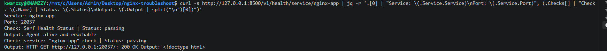

### 10.5 Browser Verification

Finally, the application was accessed through a web browser:

```text
http://127.0.0.1:20057/
```

The browser successfully displayed the Nginx welcome page.

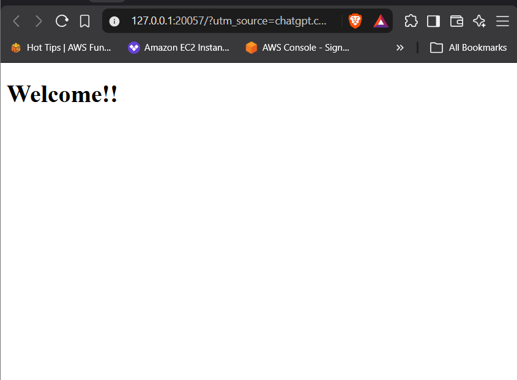

### 10.6 Dedicated Health Endpoint Verification

After implementing the custom Nginx configuration, the Docker image was rebuilt and tested locally.

The `/healthz` endpoint returned HTTP 200 OK with the expected `healthy` response. The existing homepage also continued to return HTTP 200 OK.

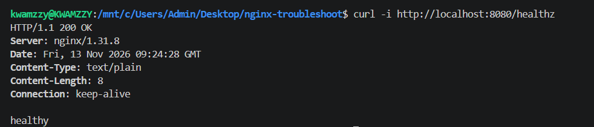

The updated Nomad job was validated and redeployed successfully. The allocation reached a healthy state with one healthy allocation and no unhealthy allocations.

The endpoint was then tested through the dynamically assigned Nomad port:

```bash
curl -i http://127.0.0.1:26304/healthz
```

The endpoint returned HTTP 200 OK with the response `healthy`.

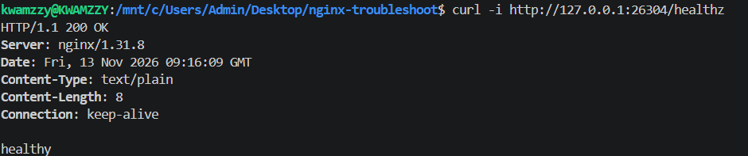

Consul was also queried to verify the registered service and its health checks. The Nomad-managed HTTP check passed and reported:

```text
Status: passing
Output: HTTP GET http://127.0.0.1:26304/healthz: 200 OK Output: healthy
```

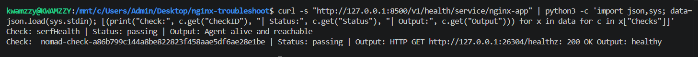

## 11. Summary of Issues and Resolutions

| Issue | Root Cause | Resolution |
|---|---|---|
| Nomad placement failure | Incorrect datacenter placeholder | Changed datacenter to `dc1` |
| Docker image pull failure | Invalid placeholder image reference | Built and used `nginx-app:local` |
| Incorrect container port | Port mapping targeted `81` | Changed target port to `80` |
| Initial HTTP health check failure | The configured `/health` endpoint did not exist | Initially changed the health-check path to `/` |
| Missing dedicated health endpoint | Nginx had no dedicated endpoint for health monitoring | Created `/healthz` in the custom Nginx configuration |
| Nomad health-check configuration | Nomad was checking the homepage instead of a dedicated health endpoint | Updated the HTTP health check to use `/healthz` |
| Application inaccessible | Docker port was not published | Added `ports = ["http"]` |

## 12. Conclusion

The troubleshooting exercise successfully identified and resolved multiple configuration issues affecting the Nginx deployment.

The main problems involved an incorrect Nomad datacenter, an inaccessible Docker image, an incorrect container port, an unsuitable health-check endpoint, and missing Docker port publishing configuration.

Following the initial fixes and mentor feedback, a custom Nginx configuration was introduced to provide a dedicated `/healthz` endpoint.

After applying the corrections:

- Nomad successfully deployed the Nginx application.
- The allocation reached a healthy state.
- Docker successfully published the application port.
- The Nginx homepage returned an HTTP `200 OK` response.
- The dedicated `/healthz` endpoint returned HTTP `200 OK` with the response `healthy`.
- Nomad successfully monitored the application through `/healthz`.
- Consul confirmed that the service health check was passing.
- The application remained accessible through a web browser.

This exercise provided practical experience in troubleshooting containerized applications, inspecting Nomad allocations, configuring Docker networking, implementing dedicated health endpoints, and integrating Nomad with Consul for service health monitoring.